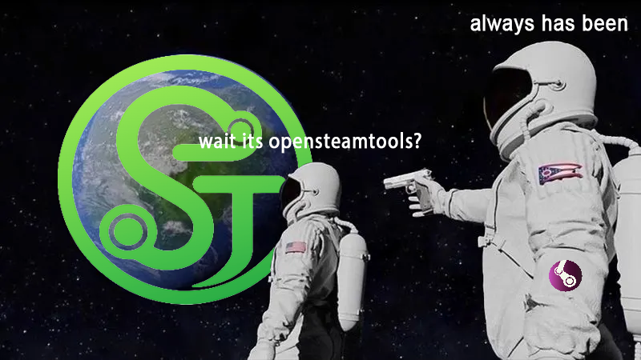

<div align="center">
  

  <h1>BaeStim 2.0.1</h1>

  <p><strong>Steam unlock tool — Lua-driven app IDs and signature-based pattern loading</strong></p>

  <p>
    
    
    
  </p>

  <p>
    <a href="README.md">English</a> &nbsp;|&nbsp;
    <a href="README_ES.md">Español</a> &nbsp;|&nbsp;
    <a href="README_ZH.md">中文</a>
  </p>
</div>

## What BaeStim does

BaeStim is a Windows-only DLL injected into Steam. It has two jobs:

1. **Unlock app IDs through Lua.** Your Lua scripts add app IDs, DLCs, depot keys,
   access tokens and tickets to the running Steam client. Scripts are hot-reloaded:
   adding, changing or deleting a `.lua` file in a watched directory takes effect
   immediately, with no Steam restart and no offline/online toggle.
2. **Load byte-pattern files for the Steam binaries.** On each launch BaeStim hashes
   `steamclient64.dll` and `steamui.dll` on disk, fetches the matching signature TOML
   from the upstream trackers, and uses it to locate the Steam functions it hooks.
   If no exact TOML exists for the running build, a bounded signature-fallback pass
   scans up to three of the newest neighbor TOMLs and reuses the best match.

### Highlights

- Unlock an unlimited number of unowned games and their DLCs.
- Load depot decryption keys, access tokens and manifest bindings from Lua.
- Fetch manifest request codes from the `baestim`, `steamrun` or `wudrm` upstream API
  (or from your own Lua endpoint — see [Manifest via Lua](#manifest-via-lua)).
- Ticket handling for Denuvo/SteamStub titles, plus local answers to legacy retail
  key requests ("Updating product key").
- Stats and achievements for unlocked games, optional game-process DLL injection,
  Steam Family Sharing support, and an optional `-onlinefix` mode.
- Optional Steam Cloud save redirection through CloudRedirect.
- One-shot warning popups: each "unsupported build" warning is shown once per
  (component, SHA-256), with a marker file under `<Steam>\baestim\markers\`.

## Installation

1. Build the project (see [Build](#build)), or grab a Release archive.
2. Copy the three DLLs — **`BaeStim.dll`**, **`dwmapi.dll`** and
   **`xinput1_4.dll`** — into the Steam root directory (the folder holding
   `steam.exe`, e.g. `C:\Program Files (x86)\Steam`). The two extra DLLs are
   loader-hijack proxies that only load BaeStim when the host process is Steam.
3. Put your Lua scripts in `<Steam>\config\baestim\` (extra directories can be
   configured in `baestim.toml`). They are loaded and executed automatically.
4. Optional: rename `baestim.example.toml` to `baestim.toml` and place it next to
   `steam.exe`. Without a config file, built-in defaults are used. The file is
   watched while Steam runs and valid changes are hot-reloaded.

**Renamed in 2.0.1:** data dir `<Steam>\opensteamtool\` → `<Steam>\baestim\`, config `opensteamtool.toml` → `baestim.toml`, Lua dir `<Steam>\config\stplug-in\` → `<Steam>\config\baestim\`. Old files are ignored.

Debug builds write logs to `<Steam>\baestim\*.log`.

### Lua quick start

```lua
addappid(1361510)                       -- unlock game 1361510
addappid(1361511, 0, "5954562e...")     -- unlock game + depot key
addtoken(1361510, "2764735786934684318")-- access token
setManifestid(1361511, "5656605350306673283") -- pin a manifest
setAppTicket(1361510, "01000000...")    -- platform credential store: AppTicket
setETicket(1361510, "01000000...")      -- platform credential store: ETicket
setStat(1361510, "76561197960287930")   -- which SteamID's stats to use
setlegacycdkey(1361510, "ABCD-EFGH-JKMN-PQRS")
```

All registered function names are case-insensitive (`addAppId`, `AddToken`,
`SETMANIFESTID`, ... are equivalent).

## Configuration

`baestim.toml` is optional and hot-reloaded. A minimal example:

```toml
[log]
level = "info"                 # Debug builds only: trace|debug|info|warn|error

[manifest]
url = "baestim"                # "baestim" | "steamrun" | "wudrm"
timeout_resolve_ms = 5000
timeout_connect_ms = 5000
timeout_send_ms = 10000
timeout_recv_ms = 10000

[lua]
paths = []                     # extra directories, loaded before <Steam>\config\baestim\

[stats]
enable_api = true              # https://stats.luastools.xyz/{appid} when no setStat

[donate]
enabled = true

[remote]
# url_template = "https://your.server/{channel}/{component}/{sha256}.toml"

[supabase]
url = ""        # Edge Function base, e.g. "https://<ref>.supabase.co"
anon_key = ""   # project anon (publishable) key; empty = remote list off

# [[inject]]
# path = "BaeStimHook.dll"
# when_appids = [1361510]
```

Remote appids are **additive** to the local Lua loaded from the same
`<Steam>\config\baestim\` directory; nothing local is replaced. The generated
`baestim-remote.lua` is rewritten wholesale on each refresh, and a copy of the
last good list is cached in `<Steam>\baestim\remote\<steamid>.json`, so an
outage never removes unlocks. When the same appid carries a depot key in two
places, the last-loaded **non-empty** key wins — do not duplicate appid keys
between local files and the remote list.

Per-user **verbatim (full-Lua) mode** is available: when the owner sets
`users.lua_text`, the generated file is exactly that pasted content (depot keys,
`setManifestid`, `addtoken`) and the structured list is ignored. See
[`supabase/README.md`](supabase/README.md#full-lua-mode).

`[[inject]]` entries load a DLL into matching game processes; each entry's
conditions (`when_cmdline`, `when_appids`, `all_games`) must all match.

### Manifest via Lua

Define `fetch_manifest_code(gid)` or the recommended
`fetch_manifest_code_ex(app_id, depot_id, gid)` in `<Steam>\config\baestim\` to
override the configured provider. The runtime exposes two helpers to Lua:

| Function | Signature | Returns |
|----------|-----------|---------|
| `http_get`  | `http_get(url [, headers])`        | `body, status_code` |
| `http_post` | `http_post(url, body [, headers])` | `body, status_code` |

`headers` is an optional table, e.g. `{["Key"] = "Value"}`.

## Steam version compatibility and signature fallback

BaeStim does not ship byte-pattern signatures inside the DLL. On every launch it
computes the SHA-256 of `steamclient64.dll` and `steamui.dll` and looks for a
matching TOML on the upstream tracker
([`OpenSteam001/steam-monitor`](https://github.com/OpenSteam001/steam-monitor),
`pattern` branch). The mirror chain is tried in order:

1. jsDelivr CDN (`cdn.jsdelivr.net`, primary — works where GitHub raw is blocked)
2. Gitea mirror (`git.lua.tools`)
3. GitHub raw (madoiscool)
4. GitHub raw (legacy OpenSteam001)
5. Local cache: `<Steam>\baestim\pattern\<component>\<sha256>.toml`

A separate `ipc` channel supplies IPC method metadata (function hashes, fenceposts,
argument counts) from the same tracker. Remote sources are consulted on every
launch so upstream re-publications are picked up automatically. A custom template
in `[remote]` replaces the built-in remote chain; the local cache remains available.

**Fallback for unknown builds.** When no TOML exists for the running DLL's exact
SHA-256, BaeStim lists up to **3 of the newest neighbor TOMLs** for that component
and signature-scans each against the loaded module (neighbor RVAs never match —
only signature scans do). The best-scanning body is saved as
`<sha256>.fallback.toml` next to the canonical cache name — an intentionally
**non-canonical** suffix, so it is never mistaken for a published TOML — and reused
on the next launch with no network traffic. The whole listing+download pass is
capped at 8 seconds so it cannot stall Steam startup.

If no body can be produced at all, a one-shot popup reports the unmatched DLL, its
SHA-256, the expected cache path and the upstream URL. Each such warning fires
**once per (component, sha)**: a marker under `<Steam>\baestim\markers\` records
that the user was already told about that build. Only hooks tied to that DLL are
disabled; the rest of BaeStim keeps working.

> One small outbound HTTPS request per DLL is made at launch (worker thread,
> ~10 KB responses); it never blocks Steam's loader.

### Debug logging

Debug builds write per-module logs under `<Steam>\baestim\`: `main.log`,
`ipc.log`, `netpacket.log`, `manifest.log`, `decryptionkey.log`, `keyvalue.log`,
`misc.log`, `achievement.log`, `pics.log`, `package.log`, `onlinefix.log`,
`richpresence.log`, `steamui.log`, `pipe.log` and `platform.log`. The verbosity is
controlled by `[log] level` in `baestim.toml`.

## Build

Requirements: Windows 10/11, CMake 3.20+, Visual Studio 2022 (MSVC x64).

```powershell
build.bat
```

The DLL output for each configuration is:

- Debug: `build/Debug/BaeStim.dll`, `build/Debug/dwmapi.dll`, `build/Debug/xinput1_4.dll`
- Release: `build/Release/BaeStim.dll`, `build/Release/dwmapi.dll`, `build/Release/xinput1_4.dll`

To run the unit tests (the test target is excluded from the default build):

```powershell
cmake --build build --config Release --target baestim_minijson_test
ctest --test-dir build -C Release --output-on-failure
```

## Disclaimer

Provided for research and educational purposes only. You are responsible for
complying with local laws, platform terms of service and software licenses.

## Attribution / License

BaeStim is based on OpenSteamTool (OpenSteam001) and its fork BetterSteamTools (madoiscool), both licensed under GPL-3.0. Source: https://github.com/OpenSteam001/OpenSteamTool and https://github.com/madoiscool/BetterSteamTools. BaeStim is distributed under the same license.

See [LICENSE](LICENSE) for the full GPL-3.0 text. The upstream projects' licenses
and attribution are preserved intact.
