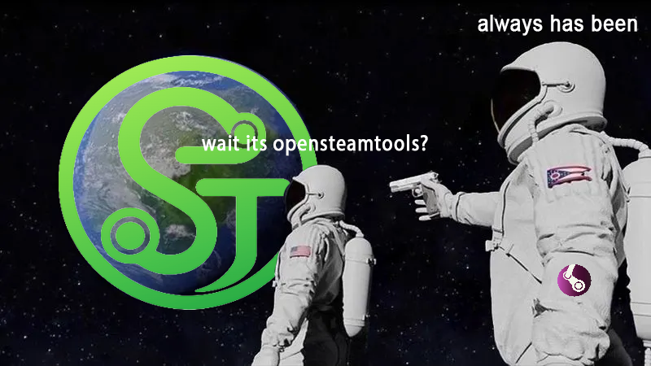

<div align="center">
  

  <h1>BaeStim 2.0.1</h1>

  <p><strong>Herramienta de desbloqueo de Steam — app IDs mediante Lua y carga de patrones por firmas</strong></p>

  <p>
    
    
    
  </p>

  <p>
    <a href="README.md">English</a> &nbsp;|&nbsp;
    <a href="README_ES.md">Español</a> &nbsp;|&nbsp;
    <a href="README_ZH.md">中文</a>
  </p>
</div>

## Qué hace BaeStim

BaeStim es una DLL de Windows que se inyecta en Steam. Tiene dos funciones:

1. **Desbloquear app IDs mediante Lua.** Tus scripts Lua añaden app IDs, DLCs,
   claves de depot, tokens de acceso y tickets al cliente de Steam en ejecución.
   Los scripts se recargan en caliente: añadir, cambiar o borrar un archivo `.lua`
   en un directorio vigilado surte efecto al instante, sin reiniciar Steam ni
   alternar entre offline/online.
2. **Cargar archivos de patrones de bytes de los binarios de Steam.** En cada
   inicio BaeStim calcula el SHA-256 de `steamclient64.dll` y `steamui.dll` en
   disco, obtiene el TOML de firmas coincidente de los rastreadores ascendentes y
   lo usa para localizar las funciones de Steam que intercepta. Si no existe un
   TOML exacto para la compilación en ejecución, una pasada acotada de fallback
   por firmas analiza hasta tres TOMLs vecinos más nuevos y reutiliza la mejor
   coincidencia.

### Características

- Desbloquea una cantidad ilimitada de juegos no poseídos y sus DLCs.
- Carga claves de descifrado de depot, tokens de acceso y fijación de manifiestos desde Lua.
- Obtiene códigos de solicitud de manifiesto de la API ascendente `baestim`,
  `steamrun` o `wudrm` (o de tu propio endpoint Lua: consulta [Manifest vía Lua](#manifest-vía-lua)).
- Gestión de tickets para títulos con Denuvo/SteamStub y respuestas locales a
  solicitudes de clave de venta minorista ("Updating product key").
- Estadísticas y logros para juegos desbloqueados, inyección opcional de DLL en
  procesos de juego, compatibilidad con Family Sharing y modo `-onlinefix`.
- Redirección opcional de partidas guardadas de Steam Cloud mediante CloudRedirect.
- Avisos emergentes de una sola vez: cada aviso de "compilación no soportada" se
   muestra una vez por (componente, SHA-256), con un marcador en
   `<Steam>\baestim\markers\`.

## Instalación

1. Compila el proyecto (consulta [Build](#build)) o usa un archivo Release.
2. Copia las tres DLLs — **`BaeStim.dll`**, **`dwmapi.dll`** y
   **`xinput1_4.dll`** — en el directorio raíz de Steam (la carpeta que contiene
   `steam.exe`, p. ej. `C:\Program Files (x86)\Steam`). Las dos DLLs adicionales
   son proxies de hijack del cargador que solo cargan BaeStim cuando el proceso
   anfitrión es Steam.
3. Coloca tus scripts Lua en `<Steam>\config\baestim\` (se pueden configurar
   directorios adicionales en `baestim.toml`). Se cargan y ejecutan automáticamente.
4. Opcional: renombra `baestim.example.toml` a `baestim.toml` y colócalo junto a
   `steam.exe`. Sin archivo de configuración se usan los valores predeterminados.
   El archivo se vigila mientras Steam está en ejecución y los cambios válidos se
   recargan en caliente.

**Renombrado en 2.0.1:** directorio de datos `<Steam>\opensteamtool\` → `<Steam>\baestim\`, config `opensteamtool.toml` → `baestim.toml`, directorio Lua `<Steam>\config\stplug-in\` → `<Steam>\config\baestim\`. Los archivos antiguos se ignoran.

Las compilaciones Debug escriben los registros en `<Steam>\baestim\*.log`.

### Inicio rápido con Lua

```lua
addappid(1361510)                       -- desbloquear el juego 1361510
addappid(1361511, 0, "5954562e...")     -- juego + clave de depot
addtoken(1361510, "2764735786934684318")-- token de acceso
setManifestid(1361511, "5656605350306673283") -- fijar un manifiesto
setAppTicket(1361510, "01000000...")    -- AppTicket en el almacén de credenciales
setETicket(1361510, "01000000...")      -- ETicket en el almacén de credenciales
setStat(1361510, "76561197960287930")   -- SteamID del que usar estadísticas
setlegacycdkey(1361510, "ABCD-EFGH-JKMN-PQRS")
```

Todos los nombres de funciones registradas son insensibles a mayúsculas
(`addAppId`, `AddToken`, `SETMANIFESTID`, ... son equivalentes).

## Configuración

`baestim.toml` es opcional y se recarga en caliente. Ejemplo mínimo:

```toml
[log]
level = "info"                 # Solo compilaciones Debug: trace|debug|info|warn|error

[manifest]
url = "baestim"                # "baestim" | "steamrun" | "wudrm"
timeout_resolve_ms = 5000
timeout_connect_ms = 5000
timeout_send_ms = 10000
timeout_recv_ms = 10000

[lua]
paths = []                     # directorios extra, se cargan antes que <Steam>\config\baestim\

[stats]
enable_api = true              # https://stats.luastools.xyz/{appid} si no hay setStat

[donate]
enabled = true

[remote]
# url_template = "https://your.server/{channel}/{component}/{sha256}.toml"

[supabase]
url = ""        # base de la Edge Function, p. ej. "https://<ref>.supabase.co"
anon_key = ""   # clave anon (publishable) del proyecto; vacía = lista remota desactivada

# [[inject]]
# path = "BaeStimHook.dll"
# when_appids = [1361510]
```

Los appids remotos son **aditivos** respecto al Lua local cargado desde el mismo
directorio `<Steam>\config\baestim\`; no se sustituye nada local. El archivo
generado `baestim-remote.lua` se reescribe por completo en cada actualización, y
una copia de la última lista válida queda en caché en
`<Steam>\baestim\remote\<steamid>.json`, de modo que una caída del servicio nunca
elimina desbloqueos. Cuando el mismo appid lleva clave de depósito en dos sitios,
gana la última clave **no vacía** cargada: no dupliques claves de appid entre los
archivos locales y la lista remota.

Existe un **modo verbatim (Lua completo) por usuario**: si el propietario rellena
`users.lua_text`, el archivo generado es exactamente ese contenido pegado (claves
de depósito, `setManifestid`, `addtoken`) y la lista estructurada se ignora. Ver
[`supabase/README.md`](supabase/README.md#full-lua-mode).

Cada entrada `[[inject]]` carga una DLL en procesos de juego coincidentes; todas
sus condiciones (`when_cmdline`, `when_appids`, `all_games`) deben cumplirse.

### Manifest vía Lua

Define `fetch_manifest_code(gid)` o (recomendado)
`fetch_manifest_code_ex(app_id, depot_id, gid)` en `<Steam>\config\baestim\` para
sustituir el proveedor configurado. El entorno ofrece dos funciones a Lua:

| Función | Firma | Devuelve |
|---------|-------|----------|
| `http_get`  | `http_get(url [, headers])`        | `body, status_code` |
| `http_post` | `http_post(url, body [, headers])` | `body, status_code` |

`headers` es una tabla opcional, p. ej. `{["Key"] = "Value"}`.

## Compatibilidad con versiones de Steam y fallback por firmas

BaeStim no incluye firmas de patrones de bytes dentro de la DLL. En cada inicio
calcula el SHA-256 de `steamclient64.dll` y `steamui.dll` y busca un TOML
coincidente en el rastreador ascendente
([`OpenSteam001/steam-monitor`](https://github.com/OpenSteam001/steam-monitor),
rama `pattern`). La cadena de espejos se prueba en orden:

1. CDN de jsDelivr (`cdn.jsdelivr.net`, fuente principal; funciona donde GitHub raw está bloqueado)
2. Espejo Gitea (`git.lua.tools`)
3. GitHub raw (madoiscool)
4. GitHub raw (OpenSteam001 heredado)
5. Caché local: `<Steam>\baestim\pattern\<componente>\<sha256>.toml`

Un canal `ipc` independiente aporta los metadatos de los métodos IPC (hashes de
función, fenceposts, número de argumentos) del mismo rastreador. Las fuentes
remotas se consultan en cada inicio para recoger automáticamente las
republicaciones ascendentes. Una plantilla personalizada en `[remote]` sustituye
la cadena remota integrada; la caché local sigue disponible.

**Fallback para compilaciones desconocidas.** Cuando no existe un TOML para el
SHA-256 exacto de la DLL en ejecución, BaeStim lista hasta **3 de los TOMLs
vecinos más nuevos** de ese componente y analiza cada uno con firmas contra el
módulo cargado (las RVAs de los vecinos nunca coinciden: solo coinciden las
firmas). El cuerpo con mejor resultado se guarda como `<sha256>.fallback.toml`
junto al nombre canónico de la caché: un sufijo **no canónico** a propósito, para
que nunca se confunda con un TOML publicado — y se reutiliza en el siguiente
inicio sin tráfico de red. Toda la pasada de listado+descarga está limitada a 8
segundos para no retrasar el inicio de Steam.

Si no se puede obtener ningún cuerpo, aparece un aviso único con la DLL no
emparejada, su SHA-256, la ruta de caché esperada y la URL de origen. Cada aviso
se emite **una vez por (componente, sha)**: un marcador en
`<Steam>\baestim\markers\` recuerda que ya se informó al usuario de esa
compilación. Solo se desactivan los hooks vinculados a esa DLL; el resto de
BaeStim sigue funcionando.

> En cada inicio se realiza una pequeña petición HTTPS por DLL (hilo de
> trabajo, respuestas de ~10 KB); nunca bloquea el cargador de Steam.

### Registros de depuración

Las compilaciones Debug escriben registros por módulo en `<Steam>\baestim\`:
`main.log`, `ipc.log`, `netpacket.log`, `manifest.log`, `decryptionkey.log`,
`keyvalue.log`, `misc.log`, `achievement.log`, `pics.log`, `package.log`,
`onlinefix.log`, `richpresence.log`, `steamui.log`, `pipe.log` y `platform.log`.
El nivel se controla con `[log] level` en `baestim.toml`.

## Build

Requisitos: Windows 10/11, CMake 3.20+, Visual Studio 2022 (MSVC x64).

```powershell
build.bat
```

Las DLLs generadas para cada configuración son:

- Debug: `build/Debug/BaeStim.dll`, `build/Debug/dwmapi.dll`, `build/Debug/xinput1_4.dll`
- Release: `build/Release/BaeStim.dll`, `build/Release/dwmapi.dll`, `build/Release/xinput1_4.dll`

Para ejecutar las pruebas unitarias (el objetivo de test se excluye del build por defecto):

```powershell
cmake --build build --config Release --target baestim_minijson_test
ctest --test-dir build -C Release --output-on-failure
```

## Aviso legal

Se ofrece solo con fines de investigación y educación. Eres responsable de
cumplir las leyes locales, los términos de servicio de la plataforma y las
licencias de software.

## Atribución / Licencia

BaeStim se basa en OpenSteamTool (OpenSteam001) y en su fork BetterSteamTools (madoiscool), ambos con licencia GPL-3.0. Fuente: https://github.com/OpenSteam001/OpenSteamTool y https://github.com/madoiscool/BetterSteamTools. BaeStim se distribuye bajo la misma licencia.

Consulta [LICENSE](LICENSE) para el texto completo de GPL-3.0. Las licencias y
atribuciones de los proyectos ascendentes se conservan intactas.
